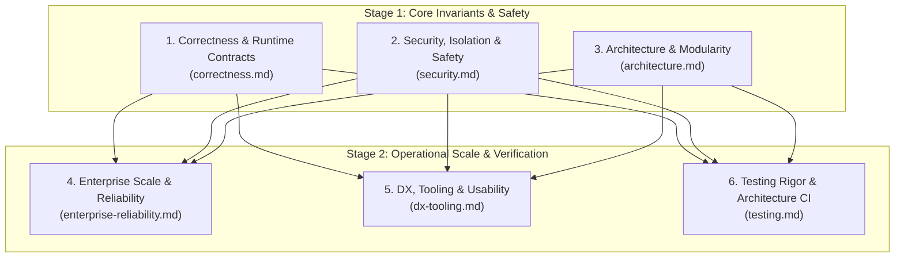

# Lens plan — Rume Whole-Document Review (v02)

Review mode: **whole-document** (confirmed).
This is the second comprehensive review of the repository, staged under `docs/reports/reviews/v02/`.
The plan governs the review only; it never outranks the code (`.opencode/rules/20-doc-tree.md`).

---

## 1. Review Scope

**In Scope** (the complete expanded codebase surface across both crates and all tests):

| Target | Subsystems & Source Files |
|---|---|
| `rume` (Core Library) | `src/app/` (builder, context, lifecycle, observability, paths, shutdown, state, mode) `src/auth/` (layer, policy, scheme, session, user) `src/cache/` (backend, config, error, health, typed) `src/config/` (builder, error, loader) `src/coordination/` (error, leader, lock) `src/enterprise/` (saml, scim) `src/env/` (error, interpolation, loading, provenance, secrets) `src/error.rs` (RFC 9457 Problem Details contracts) `src/events/` (bus, error, event, handler) `src/helpers/` (bytes, cases, duration, html, mask, ordinal, safe_equal, sentence, slug, truncate, whitespace) `src/jobs/` (context, error, handler, model, queue, registry, reliability, retry, worker) `src/metrics/` (counter, exporter, gauge, layer, registry) `src/module/` (architecture, context, dependency, error, harness, lifecycle, traits) `src/openapi/` (builder, generator, model) `src/outbox/` (error, model, relay, repository) `src/persistence/` (backend, config, error, health, memory, migration, migrator, pool, transaction) `src/prelude.rs` & `src/lib.rs` (public surface and re-exports) `src/resilience/` (circuit_breaker, concurrency, config, error, layer, rate_limiter, timeout) `src/routing/` (group, health, info, matcher, registry, rejection, router, spec, validated_param) `src/saga/` (coordinator, error, step) `src/security/` (audit, csrf, headers) `src/tenant/` (cache, error, layer, model, resolver) `src/testing.rs` & `src/validation.rs` |
| `rume-cli` (CLI Tooling) | `src/main.rs`, `cli.rs`, `prompts.rs` `src/commands/` (`new.rs`, `doctor.rs`, `codegen/`, `generate/`, `env/`, `config/`) `src/ui/` (`logger.rs`, `sticker.rs`, `table.rs`, `tasks.rs`) |
| Integration Tests | `rume/tests/` (18 test suites: `progressive_composition.rs`, `validation_suite.rs`, `persistence_integration.rs`, `auth_suite.rs`, `cache_suite.rs`, `jobs_suite.rs`, `events_suite.rs`, `openapi_suite.rs`, `outbox_suite.rs`, `job_reliability_suite.rs`, `resilience_suite.rs`, `metrics_suite.rs`, `module_testing_and_architecture_suite.rs`, `tenant_suite.rs`, `security_suite.rs`, `saga_suite.rs`, `coordination_suite.rs`, `enterprise_suite.rs`, `http_smoke.rs`, `env_and_config_loading.rs`) |

**Out of Scope**:
- `lab/` (experimental scratch space excluded from workspace).
- `target/` and generated build artifacts.
- `.opencode/` (review and prompt harness wiring).

**Baseline Verification State**:
- `#![forbid(unsafe_code)]` enforced across `rume`.
- Strict Rust 2024 edition compliance.
- `cargo test --workspace` passes 100% (154 unit tests, 18 integration suites, 2 CLI integration tests, 25 doc-tests).
- `cargo clippy --workspace --all-targets` clean (0 errors, 0 warnings).
- `cargo fmt --check` clean.

---

## 2. Continuity Requirements (from v01)

This review builds upon the findings of `docs/reports/reviews/v01/`:
- `docs/reports/reviews/v01/correctness.md` (C1–C4, m1–m4)
- `docs/reports/reviews/v01/security.md` (S-M1–S-M4, S-m1–S-m3)
- `docs/reports/reviews/v01/architecture.md` (A-M1, A-M2, m1, m2)
- `docs/reports/reviews/v01/dx-usability.md` (D-M1–D-M3, D-m1–D-m5)
- `docs/reports/reviews/v01/testing.md` (T-T1–T-T9)
- `docs/reports/reviews/v01/todo.md`

Every reviewer subagent must inspect its lens's prior findings and explicitly include a `## Prior decisions` section declaring:
- **`REAFFIRMED`**: The prior decision remains valid and the fix is verified in code.
- **`CHALLENGED`**: The prior decision is disputed or the fix introduced an unintended regression/contradiction.
- **`NOTE-NEW`**: Newly introduced capabilities or domains not covered in `v01`.

---

## 3. Lenses & Execution Graph

The review is structured as a **2-stage execution graph** (≤ 3 stages):

---

### Stage 1 (Parallel Execution)

#### Lens 1: Correctness & Runtime Contracts — `correctness.md`
- **Charter:** State machines, lifecycle sequencing, graceful shutdown drain order, transactional atomicity, outbox relay contracts, job worker graceful termination, saga forward/compensation ordering, distributed lock monotonic fencing, and RFC 9457 Problem Details consistency.
- **Code Covered:**
  - `rume/src/app/{builder,lifecycle,state,shutdown,observability}.rs`
  - `rume/src/error.rs`
  - `rume/src/persistence/{transaction,migrator,pool,memory}.rs`
  - `rume/src/outbox/{relay,repository,model}.rs`
  - `rume/src/jobs/{worker,reliability,retry,queue}.rs`
  - `rume/src/saga/{coordinator,step,error}.rs`
  - `rume/src/coordination/{lock,leader}.rs`
  - `rume/src/routing/{router,spec,validated_param}.rs`
- **Mandatory Prior Context:** `docs/reports/reviews/v01/correctness.md`, `docs/reports/reviews/v01/todo.md`.
- **Key Invariants to Check:**
  - Graceful shutdown readiness sequencing: availability transitions to `RefusingTraffic` before HTTP drain.
  - Tracing context instrumentation: spans do not hold guard across `.await`.
  - Memory transaction isolation: rollbacks occur on panic or drop without double-commit.
  - Saga reverse compensation: compensation steps must run in exact reverse chronological order of completed actions.
  - Monotonicity of distributed lock fencing tokens across lease expirations.

#### Lens 2: Security, Isolation & Safety — `security.md`
- **Charter:** Authentication schemes, session hijacking defenses, CSRF token validation (constant-time check), security headers (CSP, HSTS, X-Frame-Options), secret masking and zero-leakage error handling, path traversal sandboxing in env loading, multi-tenant data boundaries, SAML XML parsing robustness, and SCIM protocol schemas.
- **Code Covered:**
  - `rume/src/auth/{layer,policy,scheme,session,user}.rs`
  - `rume/src/security/{audit,csrf,headers}.rs`
  - `rume/src/tenant/{cache,layer,model,resolver}.rs`
  - `rume/src/enterprise/{saml,scim}.rs`
  - `rume/src/env/{loading,secrets,interpolation}.rs`
  - `rume/src/helpers/{mask,safe_equal}.rs`
  - `rume/src/error.rs`
- **Mandatory Prior Context:** `docs/reports/reviews/v01/security.md`, `docs/reports/reviews/v01/todo.md`.
- **Key Invariants to Check:**
  - `file:` env resolution rejects traversal (`..`) and absolute paths.
  - Problem Details rejection responses never leak raw secrets or dynamic internal details.
  - CSRF comparison uses constant-time `safe_equal` to avoid timing side-channels.
  - Multi-tenant cache keys and invalidation tags strictly prevent cross-tenant cache contamination.
  - SAML XML parser avoids XML entity expansion / attribute namespace collisions.

#### Lens 3: Architecture & Modularity — `architecture.md`
- **Charter:** Progressive complexity model, first-class `Module` composition, DAG cycle detection, topological dependency ordering, clean API surface of `rume::prelude`, lack of magic DI/reflection, fail-closed preflight, and encapsulation between subsystems.
- **Code Covered:**
  - `rume/src/module/{architecture,context,dependency,harness,lifecycle,traits}.rs`
  - `rume/src/app/{builder,context,mode}.rs`
  - `rume/src/events/bus.rs`
  - `rume/src/routing/{group,router}.rs`
  - `rume/src/lib.rs` & `rume/src/prelude.rs`
- **Mandatory Prior Context:** `docs/reports/reviews/v01/architecture.md`, `docs/reports/reviews/v01/todo.md`.
- **Key Invariants to Check:**
  - 3-line progressive composition (`Rume::new()`) works cleanly alongside full module builds.
  - Preflight circular dependency check detects direct (`A -> B -> A`) and indirect multi-node cycles.
  - Topological module startup and reverse topological rollback on failure.
  - Prelude does not re-export full third-party crates (reaffirming `A-M1`).

---

### Stage 2 (Parallel Execution, Dependent on Stage 1 Outputs)

#### Lens 4: Enterprise Scale & Reliability — `enterprise-reliability.md`
- **Charter:** High availability, rate limiting and shed-load concurrency bounds, distributed worker heartbeats, transactional outbox atomicity, cache-aside TTL eviction and tag-based invalidation, metrics recording and scraping overhead, multi-tenant resource boundaries, and leader election failover.
- **Code Covered:**
  - `rume/src/resilience/{circuit_breaker,concurrency,rate_limiter,timeout}.rs`
  - `rume/src/jobs/reliability.rs`
  - `rume/src/outbox/{relay,repository}.rs`
  - `rume/src/cache/{backend,health,typed}.rs`
  - `rume/src/metrics/{exporter,layer,registry}.rs`
  - `rume/src/coordination/{leader,lock}.rs`
  - `rume/src/tenant/cache.rs`
- **Dependencies & Mandatory Prior Context:** Stage 1 reports (`correctness.md`, `security.md`, `architecture.md`), `docs/reports/reviews/v01/architecture.md`.
- **Key Invariants to Check:**
  - Circuit breaker trips to Open under threshold failures, transitions to HalfOpen, and recovers.
  - Rate limiting correctly calculates sliding or fixed windows and returns 429 Problem Details.
  - Metrics layer avoids recording requests to `/metrics` itself to prevent artificial counter inflation.
  - Leader election renewal guarantees lease freshness without race conditions.

#### Lens 5: Developer Experience, CLI & Usability — `dx-tooling.md`
- **Charter:** Public API ergonomics, constructor and builder fluency, route definition elegance, error message clarity, CLI scaffolding (`rume new`, `rume doctor`, generators), configuration provenance reporting, OpenAPI schema extraction fidelity, and template portability.
- **Code Covered:**
  - `rume-cli/src/main.rs`, `cli.rs`, `commands/`, `ui/`
  - `rume/src/openapi/{builder,generator,model}.rs`
  - `rume/src/config/{builder,loader}.rs`
  - `rume/src/env/{loading,provenance}.rs`
  - `rume/src/validation.rs`
  - `rume/src/helpers/`
- **Dependencies & Mandatory Prior Context:** Stage 1 reports, `docs/reports/reviews/v01/dx-usability.md`.
- **Key Invariants to Check:**
  - `AppContext` builder replaces 6 positional arguments (reaffirming `D-M1`).
  - `rume new` project generation supports portability and does not hardcode broken relative paths.
  - OpenAPI 3.1 generator correctly maps route parameter types (`uuid`, `integer`, `string`) from registry specs.
  - CLI `doctor` and inspection commands redact sensitive variables.

#### Lens 6: Testing Rigor & Architecture CI — `testing.md`
- **Charter:** Verification depth, test harness design (`TestApp`, `ModuleHarness`), CI architecture enforcement rules (`ArchitectureRules`), integration coverage of newly introduced subsystems, edge-case and failure-mode testing, deterministic simulation of async shutdowns and timeouts.
- **Code Covered:**
  - `rume/src/testing.rs`
  - `rume/src/module/harness.rs`
  - `rume/src/module/architecture.rs`
  - `rume/tests/` (all 18 test suites)
- **Dependencies & Mandatory Prior Context:** Stage 1 reports, `docs/reports/reviews/v01/testing.md`.
- **Key Invariants to Check:**
  - `routing.rs` and all subsystems now have comprehensive test coverage (reaffirming `T-T1`).
  - `ModuleHarness` enables hermetic isolated testing of individual modules with mock dependencies.
  - `ArchitectureRules` can verify forbidden cross-domain module calls in CI.
  - Deterministic test harness simulates graceful shutdown, request drains, and circuit breaking.

---

## 4. Deliverables

Each of the 6 reviewer subagents writes its report according to the `.opencode/skills/review-authoring/SKILL.md` canonical structure:
1. `docs/reports/reviews/v02/correctness.md`
2. `docs/reports/reviews/v02/security.md`
3. `docs/reports/reviews/v02/architecture.md`
4. `docs/reports/reviews/v02/enterprise-reliability.md`
5. `docs/reports/reviews/v02/dx-tooling.md`
6. `docs/reports/reviews/v02/testing.md`

Upon completion of all 6 lens reports, the conductor derives:
7. `docs/reports/reviews/v02/todo.md` (unified execution fix order grouped by root cause and priority tiers P0–P3).
