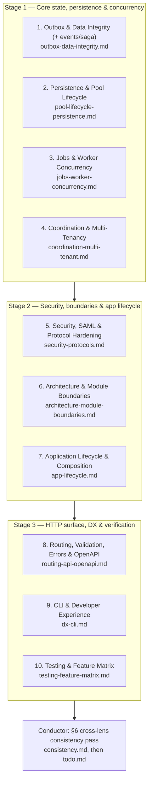

# Lens plan — Rume Whole-Document Review (v04)

Review mode: **whole-document (v04)** (confirmed by the human; not changeable by this plan).
This is the **fourth** comprehensive review of the repository, staged under `docs/reports/reviews/v04/`.
The review is a **re-review of a subject that already has prior reviews** — it builds on
`docs/reports/reviews/v01/`, `docs/reports/reviews/v02/`, `docs/reports/reviews/v03/`
(whole-document) **and** `docs/reports/reviews/v03/diff/v01/` (diff remediation review).
It never silently omits that context; every lens must carry a `## Prior decisions` section
(§3). The plan governs the review only; it never outranks the code (`.opencode/rules/20-doc-tree.md`).

---

## 1. Review scope & strategic context

**Mode**: whole-document. The review subject is the **complete current codebase within this
plan's explicitly declared code scope**, not the whole repository and not the diff since v03.
Changes since v03 are listed in §1.2 as *context only* — every lens audits its whole subject as
it exists today. Anything not named in §1.1 and not matched in §1.0 is out of scope; anything
in §1.1 is in scope regardless of whether v03 covered it.

### 1.0 Scope verification — required before Stage 1 (conductor)

Before dispatching Stage 1, the conductor verifies this plan's scope rather than trusting it
blindly:

1. Inventory every top-level module under `rume/src/` (e.g. `ls rume/src`) and every
   `rume-cli/` source/test path.
2. Match each inventory entry against exactly one of: a lens in §4, or the out-of-scope list in
   §1.3, or an explicit "out of scope" ruling recorded in the run's verification note.
3. Do the same for the workspace manifests (`Cargo.toml`, `rume/Cargo.toml`,
   `rume-cli/Cargo.toml`) and for any CI configuration present. None exists today (`.github/`
   is absent); if one is added before the run, it is in scope.
4. **Resolve every unassigned production subsystem before dispatch.** If a match cannot be made,
   assign it, carve it out with a stated reason, and record the ruling in the review folder —
   never leave it silently unreviewed.
5. Record the inventory and the resolution in `docs/reports/reviews/v04/scope-check.md` so the
   scope decision is auditable, not implied.

### 1.1 In scope

| Target | Subsystems & source files |
|---|---|
| `rume` (core library) | `src/outbox/` · `src/events/` · `src/saga/` `src/persistence/` (`backend.rs`, `config.rs`, `error.rs`, `migration.rs`, `pool.rs`, `postgres.rs`, `mysql.rs`, `sqlite.rs`, `sql/`) `src/jobs/` (`job.rs`, `queue.rs`, `error.rs`, `reliability.rs`, `retry.rs`, `worker.rs`, `postgres.rs`, `redis.rs`) `src/coordination/` (`error.rs`, `leader.rs`, `lock.rs`, `postgres.rs`, `redis.rs`) `src/tenant/` (`cache.rs`, `layer.rs`, `model.rs`, `quota.rs`, `resolver.rs`, `error.rs`) `src/cache/` (`backend.rs`, `config.rs`, `error.rs`, `typed.rs`, `redis.rs`) `src/resilience/` (`circuit_breaker.rs`, `concurrency.rs`, `rate_limiter.rs`, `redis.rs`, `timeout.rs`, `error.rs`) `src/security/` (`audit.rs`, `csrf.rs`, `headers.rs`) · `src/auth/` (`error.rs`, `identity.rs`, `layer.rs`, `policy.rs`, `schemes.rs`, `session.rs`, `redis.rs`) `src/enterprise/` (`saml.rs`, `scim.rs`) · `src/env/` (`error.rs`, `interpolation.rs`, `loading.rs`, `secrets.rs`) `src/app/` (`builder.rs`, `context.rs`, `observability.rs`, `paths.rs`, `shutdown.rs`, `state.rs`) `src/routing/` (`group.rs`, `health.rs`, `matchers.rs`, `registry.rs`, `rejection.rs`, `resource.rs`, `router.rs`, `spec.rs`, `validated_param.rs`) `src/openapi/` (`spec.rs`) · `src/validation.rs` · `src/error.rs` `src/module/` (`architecture.rs`, `context.rs`, `error.rs`, `harness.rs`, `registry.rs`) `src/metrics/` (`layer.rs`, `registry.rs`) · `src/helpers/` (all) · `src/testing/` (`app.rs`, `harness.rs`, `mod.rs`) `src/lib.rs` · `src/prelude.rs` · `src/config.rs` |
| `rume-cli` | `src/main.rs`, `cli.rs`, `prompts.rs`, `commands/` (incl. `doctor.rs`, `new.rs`, `list_routes.rs`, `codegen/`, `generate/`, `env/`, `config/`), `ui/`, `templates/` (scaffold output is part of the DX contract), `rume-cli/tests/` |
| Integration tests | `rume/tests/` — `integration.rs`, `containers.rs`, `integration/*.rs` (25 suites), `containers/*.rs` (7 suites), `common/` |

### 1.2 Context: what changed since v03 (subject remains the whole codebase)

Commits `cf82559..HEAD` (v03 baseline → today), most relevant first:

- `c550731` feat(saml) — namespace-aware SAML parser, fail-closed conditions, trust-boundary verification
- `6bd0e39` feat(pipeline) — unified PostgreSQL failure-injection enterprise pipeline; host-time eliminated from outbox retry scheduling
- `d58b2bc` feat(outbox) — heartbeat loss propagated to dispatchers; active cancellation
- `bd397cd` fix(persistence) — outbox lease renewal delegated in `DatabasePool`; DB-clock authority completed for MySQL, SQLite, job retries
- `a59bab0` / `11bbe3a` fix(leases) — DB clock authoritative across the whole lease lifecycle; outbox renewal heartbeat; worker contract tightening
- `1a3cf5f` feat(polish) — P2 batch: configurable outbox retries, rate limiting, dialect escaping
- `9c4303f` fix(testing) — in-memory fixture isolation, container bleed eliminated
- plus the v03 → `v03/diff/v01` remediation series (`d8f2a51`, `2f747ef`, `e2dfb9e`, `c2115e9`, `5fc83e8`, and the test-matrix consolidation `45c4fec`…`90a1959`, `4872fe6`, `7afc9ae`)

Every item in both `todo.md` files is marked `[x]` — reviewers treat
those as **claims to re-verify**, never as established fact.

### 1.3 Out of scope

- `lab/` (experimental scratch, excluded from the workspace)
- `target/` and all build artifacts
- `pack.md`, `pack.sh`, `opencode.sh` (snapshot/export tooling)
- `.opencode/` (harness wiring), `.zed/` (editor config), `.git/`
- `docs/` (plans, reviews, specs — non-authoritative; never a review subject)
- `Cargo.lock` (pins governed by `.opencode/rules/10-tech-stack.md`)

---

## 2. Execution graph — 3 stages, parallel within a stage

Stage K agents receive the reports of all stages < K. Conductor dispatches stages in order.

Before Stage 1: the conductor performs the §1.0 scope verification and records it in
`docs/reports/reviews/v04/scope-check.md`.
After Stage 3: the conductor performs the §6 cross-lens consistency pass and records it in
`docs/reports/reviews/v04/consistency.md`, then derives `todo.md`.

- **Stage 1**: lenses 1–4, in parallel. Independent of each other.
- **Stage 2**: lenses 5–7, in parallel. Each receives the four Stage 1 reports and must read the parts intersecting its lens (e.g. security reads them for audit/CSRF/auth-relevant claims; architecture reads them for boundary violations in pool/jobs; app-lifecycle reads them for shutdown ordering across jobs/outbox).
- **Stage 3**: lenses 8–10, in parallel. Each receives the Stage 1 + Stage 2 reports.

---

## 3. Continuity requirements & `## Prior decisions`

This re-review builds on:

| Review | Lens reports (mandatory context unless noted) |
|---|---|
| `docs/reports/reviews/v01/` | `correctness.md`, `architecture.md`, `security.md`, `dx-usability.md`, `testing.md`, `plan.md`, `todo.md` |
| `docs/reports/reviews/v02/` | `correctness.md`, `architecture.md`, `security.md`, `enterprise-reliability.md`, `dx-tooling.md`, `testing.md`, `plan.md`, `todo.md` |
| `docs/reports/reviews/v03/` | `outbox-data-integrity.md`, `pool-lifecycle-persistence.md`, `jobs-worker-concurrency.md`, `coordination-multi-tenant.md`, `security-protocols.md`, `testing-feature-matrix.md`, `plan.md`, `todo.md` |
| `docs/reports/reviews/v03/diff/v01/` | `outbox-data-integrity.md`, `pool-lifecycle-persistence.md`, `jobs-worker-concurrency.md`, `coordination-multi-tenant.md`, `security-protocols.md`, `testing-feature-matrix.md`, `plan.md`, `todo.md` |

### 3.1 Per-lens mandatory prior context

| Lens | Must read (own-lens prior reports + todos) |
|---|---|
| 1 outbox-data-integrity | `v03/outbox-data-integrity.md`, `v03/diff/v01/outbox-data-integrity.md`, `v02/enterprise-reliability.md` (outbox C2, m2, m3), `v03/todo.md` (Groups A, G, P2 outbox items), `v03/diff/v01/todo.md` (Group B), `v02/todo.md` (outbox items) |
| 2 pool-lifecycle-persistence | `v03/pool-lifecycle-persistence.md`, `v03/diff/v01/pool-lifecycle-persistence.md`, `v02/correctness.md` (M3 Migrator), `v02/enterprise-reliability.md` (C2), `v03/todo.md` (Groups B, H, P2 pool items), `v03/diff/v01/todo.md` (Groups A, E), `v02/todo.md` (persistence items) |
| 3 jobs-worker-concurrency | `v03/jobs-worker-concurrency.md`, `v03/diff/v01/jobs-worker-concurrency.md`, `v02/correctness.md` (C1, M2), `v02/enterprise-reliability.md` (M1, M2), `v02/testing.md` (M1), `v03/todo.md` (Groups C, I, P2 jobs items), `v03/diff/v01/todo.md` (Groups B, E), `v02/todo.md` (jobs items) |
| 4 coordination-multi-tenant | `v03/coordination-multi-tenant.md`, `v03/diff/v01/coordination-multi-tenant.md`, `v02/enterprise-reliability.md` (M3, M6, m4), `v02/security.md` (C2, M1, M2), `v03/todo.md` (Groups E, J, P2 coordination items), `v03/diff/v01/todo.md` (Group C), `v02/todo.md` (coordination items) |
| 5 security-protocols | `v03/security-protocols.md`, `v03/diff/v01/security-protocols.md`, `v02/security.md` (all), `v01/security.md` (S-M1..S-M4, S-m1..S-m3), `v03/todo.md` (Groups D, K, P2 security items), `v03/diff/v01/todo.md` (Group D), `v02/todo.md` (security items), `v01/todo.md` (security items) |
| 6 architecture-module-boundaries | `v02/architecture.md`, `v01/architecture.md`, `v02/testing.md` (M2 — ArchitectureRules transitive verification), `v02/todo.md` (Group G items: module boundaries, route merge, ModuleHarness), `v01/todo.md` (architecture items). **No v03 lens covered this; state so explicitly.** |
| 7 app-lifecycle | `v01/correctness.md` (app state machine, `RumeBuilder::run`, health/ops router), `v02/correctness.md`, `v02/architecture.md` (m1 ops_router, m2 shutdown.rs), `v02/dx-tooling.md` (M2 — `AppContext::builder` `S: Default`), `v02/testing.md` (M4 — TestApp lifecycle; m1 — ModuleHarness), `v02/todo.md` (app/lifecycle items). **No v03 lens covered this; state so explicitly.** |
| 8 routing-api-openapi | `v01/correctness.md` (matchers, Rejection, health routes, ROUTE_REGISTRY), `v02/correctness.md` (m1), `v02/dx-tooling.md` (M1 — OpenAPI generator discards matchers), `v02/testing.md` (insta/snapshot remediation), `v02/todo.md` (routing/OpenAPI items). **No v03 lens covered this; state so explicitly.** |
| 9 dx-cli | `v01/dx-usability.md`, `v02/dx-tooling.md`, `v02/todo.md` (DX items), `v01/todo.md` (DX items). **No v03 lens covered this; state so explicitly.** |
| 10 testing-feature-matrix | `v03/testing-feature-matrix.md`, `v03/diff/v01/testing-feature-matrix.md`, `v02/testing.md`, `v01/testing.md`, `v03/todo.md` (Groups F, L, P2 testing items), `v03/diff/v01/todo.md` (Groups A, E), `v02/todo.md` (testing items), `v03/plan.md` (matrix commands) |

**All lenses, additionally**: this plan, `.opencode/skills/review-authoring/SKILL.md`,
`.opencode/rules/70-code-rationale.md`, and the prior *todo.md* files filtered to their lens
(mandatory). A lens that skips its prior reports fails review process, not just content.

### 3.2 `## Prior decisions` — required, defined terms

Every prior finding in the lens's area is marked with exactly one of:

| Classification | Meaning |
|---|---|
| **REAFFIRMED** | Previous finding or decision remains valid; current evidence cited (file:line) showing the code satisfies it. A prior finding whose remediation is verified in current code is REAFFIRMED. |
| **CHALLENGED** | Previous finding or its remediation is defective, regressed or no longer valid. Reasoning cited; a defective remediation is also filed as a **new finding** (it does not resurrect the old ID). |
| **NOTE-NEW** | Newly identified issue in an area the prior reviews did not cover. It receives a **new finding ID** and is **not** treated as a status assigned to an old finding — it is newly reviewed coverage, not a prior decision. |

`NOTE-NEW` stays in the `## Prior decisions` section for historical visibility, but it is
classified as new coverage for an unreviewed area — it is not a disposition of any prior finding.
The section must also state explicitly when an area had **no prior coverage at all** (e.g. this
plan's restored lenses), rather than leaving the gap implied.

Silent contradiction and silent rubber-stamping are both process failures. Prior decisions
are inputs to be critically assessed, not conclusions to accept. Do **not** use the v03/diff
vocabulary (`RESOLVED`); this review uses the three terms above uniformly.

---

## 4. Lens charters & deliverables

Output file per lens: `docs/reports/reviews/v04/<lens>.md`. Every charter lists the lead
subject; agents read the whole subject, not just changed files. Line counts are indicative,
not prescriptive.

### Stage 1 — Core state, persistence & concurrency

#### Lens 1 — Outbox & Data Integrity (incl. event bus & saga)
- **Output**: `docs/reports/reviews/v04/outbox-data-integrity.md`
- **Lead subject**: `rume/src/outbox/` (`message.rs`, `relay.rs`, `repository.rs`, `error.rs`), `rume/src/events/`, `rume/src/saga/`, `rume/src/persistence/sql/{postgres,mysql,sqlite}/outbox_*.sql`, outbox paths in `{postgres,mysql,sqlite}.rs`, `tests/integration/outbox.rs`, `tests/integration/events.rs`, `tests/integration/saga.rs`
- **Charter**:
  1. **Lease-token fencing, all backends**: `mark_published` / `mark_failed` / lease renewal take and validate `lease_token`; superseded relays cannot complete messages; rows-affected asserted. Verify across Postgres, MySQL, SQLite — including the DB-clock authority refactor (`a59bab0`, `11bbe3a`, `bd397cd`): expiry now evaluated by the database, not the host.
  2. **Heartbeat loss & active cancellation**: `d58b2bc` propagates heartbeat loss to dispatchers and supports cancellation — verify dispatchers actually observe cancellation mid-dispatch, claimed messages are released/failed (not stranded), and shutdown during an in-flight dispatch cannot corrupt message state. **Do not require exactly-once.** A relay that loses its lease after an external side effect but before `mark_published` cannot be cancelled retroactively; delivery there is **at-least-once**. The verifiable invariants are: (a) a stale relay cannot renew/complete with an obsolete lease token; (b) heartbeat loss triggers cancellation of the in-flight dispatcher; (c) a cancelled or crashed dispatch is recoverable without corrupting message state; (d) where the external side effect cannot be committed atomically with the outbox, dispatch must be explicitly at-least-once and the consumer contract must carry an idempotency strategy; (e) the failure window between successful external publication and `mark_published` is **named and tested**, not assumed away.
  3. **Retry scheduling without host time**: `6bd0e39` removed host time from outbox retry scheduling — verify `next_retry_at` computation, FIFO ordering per backend, and backoff math under clock skew/batch insertion.
  4. **Recovery SQL**: `outbox_recover.sql` reclaims strictly on `lease_expires_at <= <backend wall clock>`; no message-age clauses; index usage. The wall-clock function is backend-specific — PostgreSQL `clock_timestamp()`, MySQL `UNIX_TIMESTAMP()`, SQLite `strftime('%s','now')`; `now()` is not acceptable in PostgreSQL here (it is the transaction-start timestamp, not wall clock). Verify claim, renewal, recovery and completion all use the **same** database-time semantics, in one backend and across all three.
  5. **Insert idempotency**: `outbox_insert.sql` upsert semantics (`ON CONFLICT DO NOTHING`); transactional atomicity of `TransactionalOutbox::save_tx` (commit commits both; rollback rolls back both) on all three backends.
  6. **Event bus & saga (newly in this lens; last reviewed in v02, never re-audited)**: `EventBus` subscribe/publish concurrency (`RwLock<BTreeMap<TypeId, _>>`), sync vs background dispatch error propagation, downcast safety; `Saga` compensation ordering on partial failure, `CompensationFailed` reporting, context mutation on rollback; interaction with outbox delivery (dual-write hazards). **The events and saga portions get the same depth as the outbox itself** — separate findings with their own Where/What/Why/Fix, not a blended summary; a broad "events/saga look fine" verdict is a process failure for this lens.
  7. **DLQ operability**: `failed_count` / `fetch_failed` / `reprocess_failed` semantics and retention.

#### Lens 2 — Persistence & Pool Lifecycle
- **Output**: `docs/reports/reviews/v04/pool-lifecycle-persistence.md`
- **Lead subject**: `rume/src/persistence/` (`pool.rs`, `backend.rs`, `config.rs`, `error.rs`, `migration.rs`, `postgres.rs`, `mysql.rs`, `sqlite.rs`, `sql/`), `tests/integration/persistence.rs`, `tests/containers/{postgres,mysql}.rs`
- **Charter**:
  1. **Physical pool delegation**: `DatabasePool` reflects the underlying SQLx pool (`is_closed`, size/idle telemetry); `close()` / `close_and_drain()` terminate physical connections and in-flight transactions; `DatabaseBackend::close()` implemented per backend.
  2. **Config forwarding**: `min_connections`, `idle_timeout`, `connect_timeout`/`acquire_timeout`, `max_connections` forwarded to `*PoolOptions` on all backends; `auto_migrate` — wired or explicitly removed (v03/diff m1).
  3. **Migration integrity**: single unified `rume_migrations` DDL across all creation paths (`run_pending`, `pending_migrations`, `verify_no_pending`); name/checksum columns; advisory/distributed lock for HA migration; rollback fails closed on irreversible migrations; MySQL/SQLite parity.
  4. **Error mapping**: SQLx `PoolTimedOut`/`PoolClosed`/connection errors mapped to structured `PersistenceError` variants across all backends and transactions — no flattened strings.
  5. **Multi-statement & transaction handles**: `execute` semantics, idempotent commit/rollback, auto-commit collision behavior (v03 P2 m1/m2 — fixed; re-verify).
  6. **Mariadb aliases** (`15e7c81`) and SQLx 0.8.6 specifics: type-driven query checking, `query!` vs runtime queries, SQL file externalization (`819a857`).
  7. **Ping/health**: acquisition timeouts, TCP-drop detection, behavior under pool saturation.

#### Lens 3 — Jobs & Worker Concurrency
- **Output**: `docs/reports/reviews/v04/jobs-worker-concurrency.md`
- **Lead subject**: `rume/src/jobs/` (`job.rs`, `queue.rs`, `worker.rs`, `postgres.rs`, `redis.rs`, `retry.rs`, `reliability.rs`, `error.rs`), `rume/src/persistence/sql/postgres/jobs_*.sql`, `tests/containers/jobs.rs`, `tests/containers/job_reliability.rs`
- **Charter**:
  1. **Lease fencing**: `ack`/`nack`/`dead_letter` enforce worker + lease token; completed jobs retained with TTL (no physical delete destroying the partial unique index); `jobs_claim.sql`/`jobs_reap.sql` DB-clock evaluation.
  2. **Heartbeat & cancellation**: `renew_lease` API and `JobWorker` background heartbeat; heartbeat-loss propagation to `JobContext` (`d58b2bc`); cancellation token honored mid-handler; DLQ routing on heartbeat loss (not silent abandonment).
  3. **Panic isolation**: `AssertUnwindSafe(fut).catch_unwind().await` around the *future*, not its construction; handler panic → DLQ with error context + idempotency release.
  4. **Idempotency store**: Lua-scripted `release`/`complete` verify worker tokens; completed-record eviction (v03/diff M1); tenant-namespaced keys; `InProgress` semantics on duplicate.
  5. **Reliability loops**: worker-node heartbeat vs job-lease heartbeat split-brain; abandoned-worker recovery; poll-error backoff; `enqueue_delayed` race resolution; `RetryPolicy` jitter/overflow.
  6. **Clock authority for the job backends that exist — PostgreSQL and Redis only**: verify database-clock authority for PostgreSQL job lease and retry decisions (`clock_timestamp()` paths across `jobs_claim.sql`, `jobs_reap.sql`, `ack`/`nack`/`dead_letter`/`renew_lease`). Independently verify Redis job lease, expiry and retry semantics using **Redis server-side time** (e.g. `TIME`/`PEXPIRE`/`ZSET` scores evaluated by the server), not host-side `SystemTime::now()` — flag wherever the implementation computes expiry from the host clock. **Do not impose MySQL/SQLite job parity** — those are not supported job backends today.

#### Lens 4 — Coordination & Multi-Tenancy
- **Output**: `docs/reports/reviews/v04/coordination-multi-tenant.md`
- **Lead subject**: `rume/src/coordination/` (`postgres.rs`, `redis.rs`, `lock.rs`, `leader.rs`), `rume/src/tenant/` (`cache.rs`, `quota.rs`, `resolver.rs`, `layer.rs`, `model.rs`), `rume/src/cache/`, `rume/src/resilience/` (`rate_limiter.rs`, `redis.rs`, `circuit_breaker.rs`), `rume/src/persistence/sql/postgres/{lock,leader}_*.sql`, `tests/integration/{coordination,tenant,cache,resilience}.rs`, `tests/containers/{redis,coordination}.rs`
- **Charter**:
  1. **Fencing & leader terms**: monotonic terms on *every* acquisition (incl. crash re-acquire); server-side `clock_timestamp()` evaluation; renewal fails after expiry; fencing tokens surfaced to callers for downstream validation.
  2. **Redis Cluster safety**: `{...}` hash tags on all multi-key scripts (lock, leader, idempotency, cache tags); Lua script atomicity; timeout safety; `RedisRateLimiter` error classification (not everything = `CircuitOpen`).
  3. **Tenant isolation**: tenant-namespaced keys everywhere (jobs, idempotency, cache, rate limit, quotas); `TenantScopedCache` quota under TTL expiry (sorted-set design from v03/diff — verify); resolver conflict semantics (duplicate slug → error, not silent overwrite); case-insensitive/IPv6 host handling; cross-tenant leak impossible across cache/pool/rate-limit.
  4. **Rate limiter**: sharding/lock granularity, eviction strategy, tenant-keyed limits, `x-forwarded-for` trust model.
  5. **Lock/leader operational hygiene**: `prune_expired()` retention; expired-row cleanup; fencing telemetry (`LockGuard`/`LeaderLease` expiration visibility).

### Stage 2 — Security, boundaries & application lifecycle

#### Lens 5 — Security, SAML & Protocol Hardening
- **Output**: `docs/reports/reviews/v04/security-protocols.md`
- **Lead subject**: `rume/src/security/` (`audit.rs`, `csrf.rs`, `headers.rs`), `rume/src/auth/`, `rume/src/enterprise/` (`saml.rs`, `scim.rs`), `rume/src/env/` (`secrets.rs`, `loading.rs`, `interpolation.rs`), `rume/src/helpers/` (`safe_equal.rs`, `html.rs`, `mask.rs`), `tests/integration/{security,enterprise,auth}.rs`
- **This lens is large by design. Findings and evidence must be per subsystem** — SAML, SCIM, CSRF, sessions, audit/secrets, headers, auth policy each get their own findings, file:line and verdict. One blended "security is fine/weak" verdict is a process failure; if a subsystem cannot be assessed, say so explicitly rather than covering it with a general statement.
- **Charter**:
  1. **SAML after `c550731`**: namespace-aware parser; XSW resistance — is the signed element cryptographically bound to the assertion actually consumed (Response vs Assertion envelope signing, Okta/Azure/ADFS compatibility)? Fail-closed conditions (`NotBefore`/`NotOnOrAfter`, clock skew); trust-boundary verification of audience/issuer; comment truncation; verifier mandatory on every production path.
  2. **CSRF**: HMAC secret handling (generated vs configured; startup fail-closed?), multi-cookie traversal, SameSite/cookie_secure defaults, constant-time comparison, subdomain tossing.
  3. **Sessions**: fixation rotation on privilege change, Redis store failure propagation (no silent guest degradation), stale-cookie fallback semantics.
  4. **Audit & secrets**: parameterized `SqlAuditLogger`; metadata redaction via `env::secrets::redact_value`; audit durability/unforgeability; `file:` env loading traversal; secret URL/credential redaction in diagnostics; `redact()` heuristic coverage.
  5. **Headers & proxy trust**: HSTS/`x-forwarded-proto` trust model, CSP, framing; `SecurityHeadersLayer` behavior over plain HTTP; `safe_equal` usage audit.
  6. **SCIM**: ETag/`meta.version` optimistic concurrency; RFC 7643/7644 conformance spot-checks; authn of SCIM endpoints.

#### Lens 6 — Architecture & Module Boundaries (restored; dropped in v03)
- **Output**: `docs/reports/reviews/v04/architecture-module-boundaries.md`
- **Lead subject**: `rume/src/lib.rs`, `src/prelude.rs`, `src/module/` (`architecture.rs`, `context.rs`, `error.rs`, `harness.rs`, `registry.rs`), `src/config.rs`, `src/env/` (loading/interpolation — architecture, not secrets), `src/helpers/` (remainder), `rume/Cargo.toml` + root `Cargo.toml`, `tests/integration/{architecture,composition}.rs`
- **Charter**:
  1. **Refusal constraints** (from `.opencode/rules/60-architecture.md`, non-negotiable): no runtime DI container; no classpath/module scanning; no hidden AOP (`@Transactional`-style); no mandatory ORM/database; typed config validated at boot (no stringly templating). Flag any drift, however small.
  2. **Crate boundaries & features**: `rume` core free of heavy optional deps (all persistence/redis behind features — verify `cargo tree`-level hygiene from manifests); `rume-cli` depends on `rume`, never reimplements core logic; optional features additive-only; `--no-default-features` surface compiles; `#![forbid(unsafe_code)]` intact.
  3. **Env/Config split**: layered `.env` + process env (`Env`) vs declarative TOML under `config/` (`Config`); validation into Rust types at boot; provenance reporting; interpolation errors name the variable.
  4. **Module system**: `ModuleRegistry` startup ordering (cycles fail), lifecycle hooks visible (`on_start`/`on_shutdown`, rollback on partial start failure), `ArchitectureRules::verify` transitive reachability, route-merge collision handling (fail preflight, no panics), `ModuleHarness`.
  5. **Public surface**: `prelude.rs` minimalism; re-export discipline (no niche enterprise types in prelude); documented stability; `testing` module gating.
  6. **Leaf utilities**: `helpers/` correctness + placement (generic, not domain-specific); no junk drawers.

#### Lens 7 — Application Lifecycle & Composition
- **Output**: `docs/reports/reviews/v04/app-lifecycle.md`
- **Lead subject**: `rume/src/app/` (`builder.rs`, `context.rs`, `state.rs`, `shutdown.rs`, `observability.rs`, `paths.rs`), `src/routing/health.rs` only as it binds to availability, `tests/integration/{lifecycle,http_smoke,composition,health}.rs`
- **Charter**:
  1. **Lifecycle/availability state machine**: atomic `u8` states in `state.rs` (incl. `ApplicationMode`, `LifecycleState`), transition validity, terminal states, unknown-value mapping; refusal-to-serve semantics.
  2. **Build & middleware fail-closed**: duplicate/unknown middleware/group names error before serving; group membership validation; `build_router` vs `run` parity; module-merge collisions.
  3. **Graceful shutdown**: signal handling, drain ordering (stop accept → in-flight drain → `on_shutdown` hooks → availability transitions), `shutdown_timeout` enforcement, shutdown during startup, TestApp teardown parity with `run()` (module hooks executed; rollback on failure).
  4. **Observability wiring**: request identity propagation, tracing spans, problem-details propagation, metrics layer ordering; `init_tracing` fallibility.
  5. **Availability vs health**: `/health/live` vs `/health/ready` semantics vs `Availability` atomics; `ops_router` divergence (v01/v02 m1 — removed? verify); `AppContext` builder ergonomics (v02 M2 — `S: Default` leak).
  6. **Bind/address handling**, `ApplicationMode`, path resolution (`ProjectPaths`), mode-dependent behavior.

### Stage 3 — HTTP surface, DX & verification

#### Lens 8 — Routing, Validation, Errors & OpenAPI
- **Output**: `docs/reports/reviews/v04/routing-api-openapi.md`
- **Lead subject**: `rume/src/routing/` (`group.rs`, `health.rs`, `matchers.rs`, `registry.rs`, `rejection.rs`, `resource.rs`, `router.rs`, `spec.rs`, `validated_param.rs`), `src/openapi/`, `src/validation.rs`, `src/error.rs`, `src/metrics/`, `tests/integration/{routing,validation,openapi,metrics,route_metadata,error,error_redaction,health,request_identity}.rs`
- **Charter**:
  1. **Matcher & routing correctness**: `Number`/`Uuid`/`Slug` edge cases; `ValidatedParam`; route registry (`ROUTE_REGISTRY` poisoning, side-effect-in-`build()`); `RouteSpec`/`RouteGroup`/`Resource` semantics; rejection → status mapping.
  2. **Health subsystem** (869-line `routing/health.rs` — audit hard): check aggregation, caching/TTL, timeouts, partial failure reporting, probe-race behavior, `debug_info` minimality.
  3. **Error contracts**: RFC 9457 Problem Details; public/internal split — no internal detail leakage; `Validation` details; status mapping table vs docs; redaction of error chains.
  4. **OpenAPI generation** (`v02` M1 — generator discarded matchers; fixed? verify): route registration → spec fidelity; parameter in/path/query inference; response schema refs; security schemes; snapshot tests (`insta`).
  5. **Validation extractors**: `Validated<T>` (garde) mapping 400 vs 422; query/path/form extraction; error body shape stability.
  6. **Metrics**: registry, latency tracking (bounded heap), `/metrics` endpoint exposure, layer overhead, no unbounded cardinality.

#### Lens 9 — CLI & Developer Experience (restored; dropped in v03)
- **Output**: `docs/reports/reviews/v04/dx-cli.md`
- **Lead subject**: `rume-cli/` (all: `main.rs`, `cli.rs`, `prompts.rs`, `commands/` incl. `doctor.rs`, `new.rs`, `list_routes.rs`, `codegen/`, `generate/`, `env/`, `config/`, `ui/`, `templates/`, `tests/`)
- **Charter**:
  1. **Scaffold correctness**: `rume new` output compiles and runs out of the box; template/doc drift (README routes, health paths — v02 M5); generated code passes the project's own lint bar; templates use current APIs.
  2. **`doctor` & inspection commands**: honest diagnostics (no false positives masking broken environments); `env:check`/`config:check` secret redaction (`--unredacted` gating); `list_routes` fidelity vs actual router.
  3. **Error UX**: actionable messages, exit codes, `--format json` consistency across commands (v02 m2), no panics on malformed input/config.
  4. **Codegen/generate**: naming, idempotency, mod.rs regeneration safety, dry-run/diff behavior; overwrite protection.
  5. **CLI ↔ core coupling**: CLI uses `rume` public API only; no duplicated logic drifting from core behavior.
  6. **Prompts & UI**: non-TTY behavior, cancellation, `is_terminal` gating.

#### Lens 10 — Testing & Feature Matrix
- **Output**: `docs/reports/reviews/v04/testing-feature-matrix.md`
- **Lead subject**: `rume/Cargo.toml`, root `Cargo.toml`, `rume/tests/` (`integration.rs`, `containers.rs`, `integration/*.rs`, `containers/*.rs`, `common/`), `rume/src/testing/`
- **Charter**:
  1. **Feature matrix builds**: `cargo check`/`test` under `--no-default-features`, `--features sqlite|postgres|mysql|redis`, `--all-features`; `[[test]]` gates; dev-dependencies available to all feature combos; `#![forbid(unsafe_code)]` in test entrypoints vs `#![deny]` consistency.
  2. **2-binary architecture**: `integration` (zero-docker) vs `containers` (live) — is the zero-docker contract real (no container spin-ups sneaking in)? Feature gates on shared `common/` modules.
  3. **Container fixtures**: `OnceCell` sharing, per-test DB/schema isolation (`test_{uuid}`), suite parallelism, Docker-daemon pressure, bleed into wrong binaries.
  4. **Determinism**: no wall-clock `sleep()` in tests (audit all remaining); `Notify`/virtual time/`yield_now` usage; flake risks in concurrent tests.
  5. **Harness & tooling**: `RumeTestHarness` ergonomics and coverage; `insta` snapshots for OpenAPI/Problem Details; `rstest` fixtures; `wiremock` for IdP/webhooks; failure-mode assertions (lease loss, connection drop, duplicate ID) — negative-path coverage vs happy-path bias.
  6. **Coverage gaps & redundancy**: unit vs integration placement per `.opencode/rules/testing.md`; duplicated assertions; untested error paths in new code (events/saga/SAML pipeline).

---

## 5. Deliverables & execution rules

1. Each lens produces **exactly one** report: `docs/reports/reviews/v04/<lens>.md`. Lens agents write nothing else. The conductor's process artifacts — `scope-check.md` (§1.0) and `consistency.md` (§6) — are not lens reports and are expected.
2. Reports follow `.opencode/skills/review-authoring/SKILL.md` canonical structure, in order:
   `# <Lens> Review — v04` → `## Summary` → `## Prior decisions` → `## Findings` (C/M/m) →
   `## Positive notes` → `## Verdict`.
3. Findings carry **Where / What it says / Why it's a problem / Suggested fix**; numbered per
   severity (`C1…`, `M1…`, `m1…`), never renumbered. Severity = consequence, not confidence.
   Grade C only for shipped-harm defects; M for implementer-blocking design problems; m for polish.
4. `## Prior decisions` mandatory per §3.2 (every prior finding in the lens area, one of the three terms, with evidence).
5. **Root cause stated explicitly** when suspected — the conductor's `todo.md` groups by shared root cause; say "this and the two X findings are the same missing rule" when true.
6. Whole-document mode ⇒ the Verdict answers "is this ready to proceed / ship?" outright. No hedging, no open-ended verdicts.
7. Reviewers are fresh subagents; **no one reviews their own work**. Reviewers **must not modify source** under any circumstances. Read-only verification commands (`cargo check`, `cargo test`, feature-matrix builds) are allowed and encouraged where they settle a question — but a green build is never a substitute for reading the code, and they must not run destructive/db-destructive operations outside the test harness.
8. Reviewers may browse official docs for library/API behavior; they may not use the web to invent project-specific requirements.
9. **The conductor (not the lenses, not this plan) derives `docs/reports/reviews/v04/todo.md` afterwards** — but only after the §6 cross-lens consistency pass is complete. `todo.md` orders all findings by execution priority `P0`–`P3` with shared root causes grouped for solving together. Lenses must therefore keep findings compressible to one actionable line.
10. Reports are non-authoritative; the code is the source of truth. Where a report and the code disagree, the code wins and the report gets a ruling.
11. Every claim verified against the actual file; hedging language before evidence is a stop-and-verify signal. Quote rationale comments when flagging commented choices (`70-code-rationale.md`).
12. **Evidence is recorded, not implied.** Every finding distinguishes:
    - **Static verification** — the source and call path were actually read (file:line cited);
    - **Executed verification** — the exact command, feature flags and result (e.g.
      `cargo test -p rume --all-features --test containers` → `17 passed, 0 failed`);
    - **Not executed** — what could not be verified and why (no Docker daemon, feature gate,
      missing service, time budget).

    A report must never write "X works" from implementation alone; it must name the call path
    and whether the relevant test was actually executed. Reports that cannot execute anything
    must say so plainly instead of borrowing confidence from the green build.

---

## 6. Conductor cross-lens consistency pass (mandatory, before `todo.md`)

Between the last lens report and `todo.md`, the conductor performs a **cross-lens consistency
synthesis** and records it as `docs/reports/reviews/v04/consistency.md`. This is a conductor
responsibility, not an eleventh lens, and it **must not produce new findings** — it reconciles
the findings the lenses already reported.

The pass checks, at minimum:

1. **Cross-lens duplicates** — the same defect reported under different names. Identify the
   canonical finding and cross-reference the others; never silently merge. Record each merge
   decision in `consistency.md`.
2. **Contradictions** — one lens's recommended fix conflicts with another's (e.g. a persistence
   change that invalidates an jobs-lens assumption). Resolve by reading the code; record the
   ruling and the losing recommendation.
3. **Cross-lens dependencies** — a finding in one subsystem changes the interpretation, severity,
   or fix order of another (e.g. a migration-schema defect that invalidates a jobs/outbox
   remediation assumed to sit on top of it). Note the dependency explicitly.
4. **Ownership and acceptance criteria** — every Critical (C) and Major (M) finding has exactly
   one owning lens and a concrete acceptance criterion (what must be true in code/tests for it
   to be considered fixed). Findings spanning lenses get one owner; the others reference it.
5. **Dependency-respecting order** — remediation order honours what unblocks what (a fix that
   another fix depends on comes first), not merely severity order.
6. **Unreconciled gaps** — if the pass surfaces a defect no lens reported, that is a signal the
   lens plan had a gap. Say so in `consistency.md` and report it to the human; do not smuggle
   the finding into `todo.md`.

`todo.md` is derived **only after this pass is complete**. If the pass changes a finding's
meaning, the lens reports stand as written (they are evidence, not truth) and the ruling goes
in `consistency.md`.

---

## 7. Lens set vs v03 — what changed and why

| v03 lens | v04 disposition | Why |
|---|---|---|
| `outbox-data-integrity` | **Kept; expanded** (+ `src/events/`, `src/saga/`) | Highest-risk data path; heavy recent churn (`d58b2bc`, `bd397cd`, `a59bab0`, `11bbe3a`, `6bd0e39`). Events/saga were last reviewed in v02 and never re-audited after Phase 4/5; folded here as event-delivery semantics rather than given a thin standalone lens. |
| `pool-lifecycle-persistence` | **Kept** | Physical-pool delegation and migration integrity were C/M-grade in v03 and v03/diff/v01; fixes need whole-document re-verification. |
| `jobs-worker-concurrency` | **Kept** | Lease fencing, heartbeat, cancellation — the most defect-dense area across both prior reviews; recent commits touched exactly this. |
| `coordination-multi-tenant` | **Kept; moved to Stage 1** | Same rationale; independent of L1–L3, so parallelized earlier to feed Stage 2 sooner. |
| `security-protocols` | **Kept** | `c550731` reworked SAML parsing wholesale; CSRF/session remediation needs re-verification; secrets handling spans env/audit/CLI boundaries. |
| `testing-feature-matrix` | **Kept; moved to Stage 3** | The 2-binary consolidation and container fixtures are new architecture; the feature matrix must be re-verified against current manifests. |
| — | **NEW** `architecture-module-boundaries` | Dropped in v03; refusal constraints (no DI container, no scanning, no hidden AOP, typed config) are hard rules with zero v03 coverage; module system changed since v02. |
| — | **NEW** `app-lifecycle` | Dropped in v03; `builder.rs` (1816 lines), lifecycle/availability atomics, graceful shutdown, TestApp parity — unaudited since v02, changed since (Groups I/L). |
| — | **NEW** `routing-api-openapi` | Dropped in v03; routing/health (869-line health.rs), RFC 9457 errors, OpenAPI generator (v02 M1 fix), validation extractors — unaudited since v02. |
| — | **NEW** `dx-cli` | Dropped in v03; CLI is user-facing contract (scaffold, doctor, codegen); unaudited since v02 (v01 S-M3/D-M* fixed then; verify no regressions). |

No v03 lens was dropped. Net: 6 → 10 lenses; the four additions restore the surfaces v03
omitted, each justified above. Stage count stays ≤ 3.
